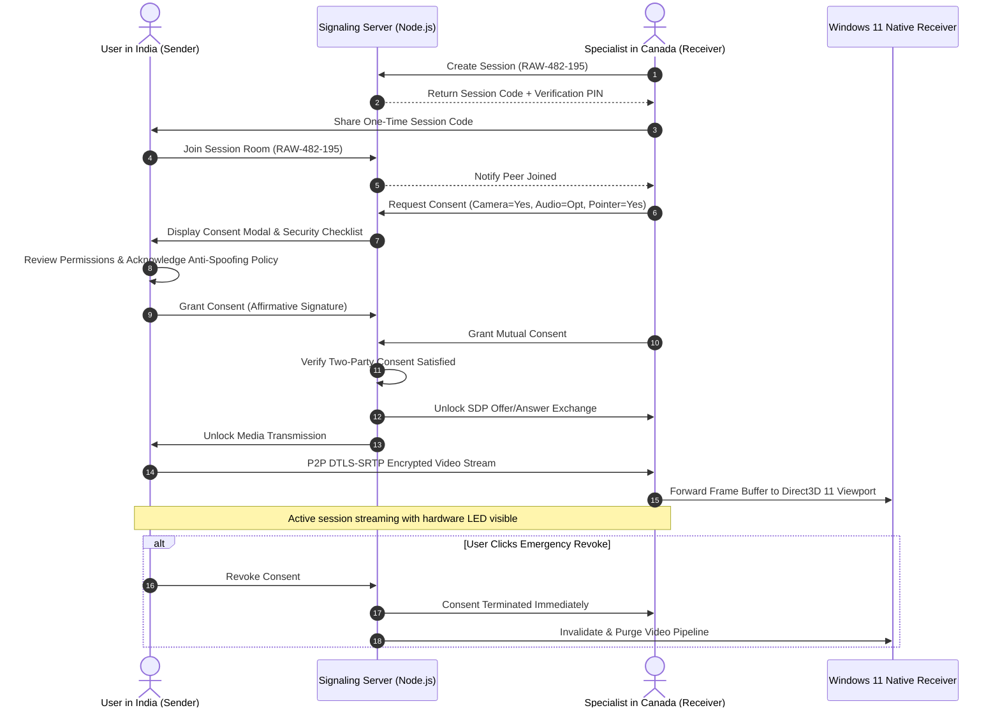

# RemoteAssist WinCam — System Architecture Specification

## 1. Executive Summary & Purpose

**RemoteAssist WinCam** is a consent-governed remote video communication and application-support system engineered for two users in disparate international geographies, specifically configured for the **India (IN) ↔ Canada (CA)** trans-continental corridor.

The system combines a low-friction web client (for camera senders and specialists) with a high-performance **Windows 11 Native Receiver (C++17/20, Direct3D 11, Media Foundation)** to deliver high frame-rate, low-latency visual assistance without compromising user autonomy, privacy, or operating system integrity.

---

## 2. Ethical Guardrails & Security Non-Negotiables

To prevent abuse, surveillance, or unauthorized takeover, the system enforces hard boundaries:

1. **Strict Mutual Consent**: Video and audio transmission requires affirmative, cryptographic authorization from both the sender and the receiver. No stream can be initiated unilaterally.
2. **No Remote Control**: RemoteAssist WinCam does **not** inject synthetic keyboard, mouse, or touch events into the host OS. Assistance is strictly visual (via pointer guidance overlays and video streaming).
3. **No Camera Spoofing**: The system does not tamper with hardware camera identifiers or biometric authentication devices (Windows Hello).
4. **Transparent OS Indicators**: The native receiver and web senders integrate with Windows 11 camera privacy notifications (Taskbar active camera glyph and hardware LED illumination).
5. **Instant Revocation**: Either party can unilaterally revoke consent at any millisecond, immediately terminating the DTLS-SRTP media pipeline and purging frame buffers.

---

## 3. High-Level Architecture Diagram

```
+---------------------------------------------------------------------------------------------------------+
|                                    REMOTEASSIST WINCAM ARCHITECTURE                                      |
+---------------------------------------------------------------------------------------------------------+

  [ INDIA (Origin: Camera Sender) ]                                 [ CANADA (Specialist / Receiver) ]
  +--------------------------------+                                 +-----------------------------------+
  |  Sender Client (React/Vite)    |                                 |   Web Dashboard (React/Vite)      |
  |  - Camera Hardware LED Active  |                                 |   - Accessible Light Theme        |
  |  - Explicit Consent Checklist  |                                 |   - Cross-Border Latency Monitor  |
  |  - WebRTC Media Capture API    |                                 |   - Visual Pointer Overlay        |
  +---------------+----------------+                                 +-----------------+-----------------+
                  |                                                                    |
                  |                                                                    | (Local IPC / Bridge)
                  |                                                                    v
                  |                                                  +-----------------------------------+
                  |                                                  | Windows 11 Native Receiver (C++)  |
                  |                                                  | - Direct3D 11 SwapChain Present   |
                  |                                                  | - Media Foundation IMFVirtualCam  |
                  |                                                  | - OS Camera Privacy Tray Aware    |
                  +---------------+                                  +-----------------+-----------------+
                                  |                                                    |
                                  v                                                    v
                    +--------------------------------------------------------------------+
                    |                    Cross-Border Signaling Gateway                  |
                    |              Node.js + Express + TypeScript + Socket.IO            |
                    |              - Session Token & PIN Verification                    |
                    |              - Mutual Consent State Machine                        |
                    |              - PostgreSQL + Prisma Audit Trail                     |
                    +---------------------------------+----------------------------------+
                                                      |
                                                      v
                                        +----------------------------+
                                        |   Global STUN / TURN Pool  |
                                        |   - STUN Reflexive (P2P)   |
                                        |   - TURN Relay Fallback    |
                                        +----------------------------+
```

---

## 4. Cross-Border Corridor Telemetry (India ↔ Canada)

Trans-continental WebRTC connections between South Asia (e.g., Mumbai / Bangalore) and North America (e.g., Toronto / Vancouver) encounter physical propagation delays of approximately **170ms to 230ms Round-Trip Time (RTT)** across submarine fiber cables.

| Metric                    | Target            | Fail-Safe Threshold | Mitigation Mechanism                               |
| ------------------------- | ----------------- | ------------------- | -------------------------------------------------- |
| **Round Trip Time (RTT)** | 180ms – 220ms     | > 350ms             | Dynamic adaptive bitrate, Congestion Control (GCC) |
| **Jitter**                | < 15ms            | > 40ms              | WebRTC NetEq adaptive jitter buffer                |
| **Packet Loss**           | < 1.0%            | > 4.0%              | Forward Error Correction (RED / ULPFEC)            |
| **Resolution / FPS**      | 1080p @ 30 FPS    | 720p @ 24 FPS       | VP8 / H.264 temporal layering fallback             |
| **NAT Traversal**         | Direct STUN srflx | Symmetric NAT       | Turn server relay via lowest-latency regional POP  |

---

## 5. Mutual Consent Handshake Sequence



---

## 6. Monorepo Organization

```
remoteassist-wincam/
├── apps/
│   ├── web-dashboard/              # Specialist light-themed React + Vite + Tailwind dashboard
│   └── sender-client/              # End-user camera sender application with consent UI
├── services/
│   └── signaling-server/           # Node.js + Express + Socket.IO + Prisma PostgreSQL signaling
├── native/
│   ├── windows-receiver/           # C++17 Windows 11 receiver (Direct3D 11, Media Foundation)
│   └── virtual-camera-research/    # Windows 11 IMFVirtualCamera API research & prototype
├── packages/
│   └── shared-types/               # Shared TypeScript schemas, signaling contracts, metrics
├── tests/
│   ├── unit/                       # Vitest test suite for consent, session store, types
│   └── e2e/                        # Playwright browser end-to-end test suite
└── docs/                           # Architecture, security, API, and build guides
```

---

## 7. Windows 11 Systems Integration

1. **Direct3D 11 Pipeline**:
   - Uses `D3D11CreateDeviceAndSwapChain` with `DXGI_SWAP_EFFECT_DISCARD` or `DXGI_SWAP_EFFECT_FLIP_DISCARD` for ultra-low presentation latency.
   - Automatically falls back to WARP (software rasterizer) if run in headless or virtualized environments.
2. **Media Foundation Virtual Camera**:
   - Implements `IMFVirtualCamera` user-mode registration in Windows 11 (Build 22000+).
   - Eliminates kernel-mode instability while maintaining complete OS privacy transparency.
3. **Audit Trail**:
   - All session initiations, invitations, consent grants, and revocations are immutably logged with UTC timestamps and IP hashes for enterprise compliance.
