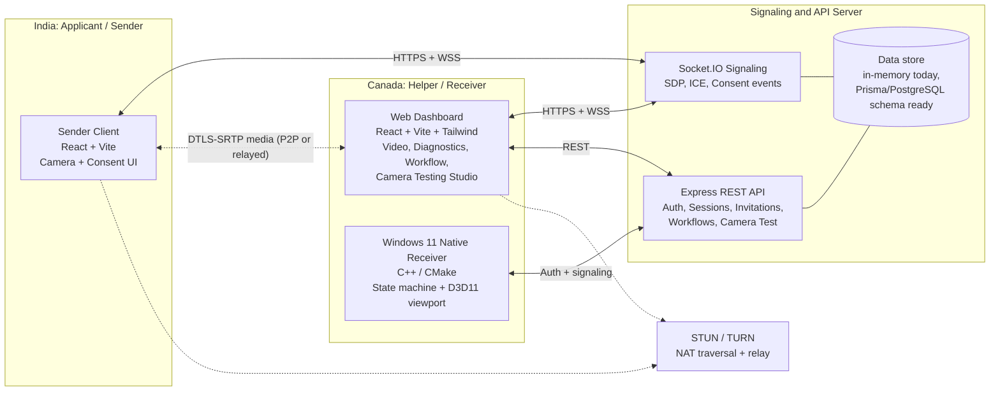
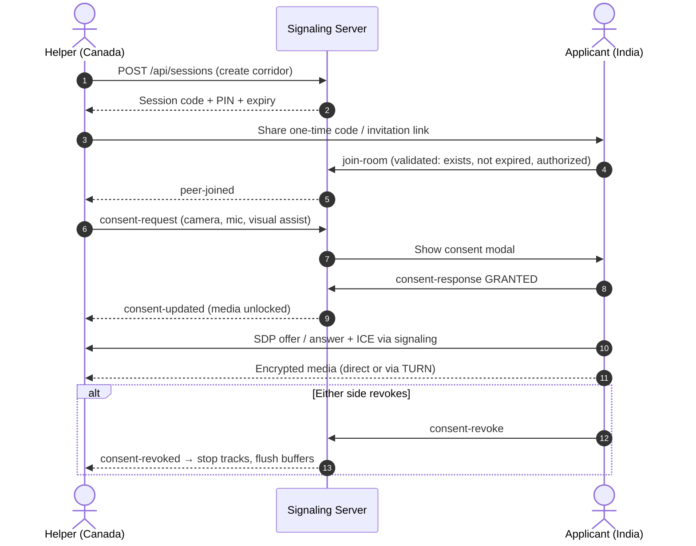

# RemoteAssist WinCam

[](#license)
[](#technology-stack)
[](#technology-stack)
[](#technology-stack)
[](#webrtc-and-cross-network-connectivity)
[](#windows-11-native-receiver)
[](#windows-11-native-receiver)

> **A consent-first remote video communication and application-support platform for two people in different countries, such as India and Canada, built with WebRTC, a secure signaling server, a React dashboard, a camera diagnostics studio, and a native Windows 11 receiver.**

---

## Table of Contents

1. [Purpose of the Project](#purpose-of-the-project)
2. [The Problem It Solves](#the-problem-it-solves)
3. [Key Innovations](#key-innovations)
4. [Feature Overview](#feature-overview)
5. [System Architecture](#system-architecture)
6. [Technology Stack](#technology-stack)
7. [Repository Structure](#repository-structure)
8. [Getting Started](#getting-started)
9. [Using the Application](#using-the-application)
10. [Testing and Quality](#testing-and-quality)
11. [Security and Ethics](#security-and-ethics)
12. [Project Status and Known Limitations](#project-status-and-known-limitations)
13. [Documentation Index](#documentation-index)
14. [Developer](#developer)
15. [License](#license)

---

## Purpose of the Project

**RemoteAssist WinCam** lets a **helper** (for example, a support specialist in Canada) guide an **applicant** (for example, someone in India) through an application process, such as a job, visa, or document workflow, using live video. Neither person needs to share a network, use a USB connection, or install heavy conferencing software.

The project is built on three core principles:

| Principle         | What it means in practice                                                                                                                 |
| :---------------- | :---------------------------------------------------------------------------------------------------------------------------------------- |
| **Consent first** | No camera, microphone, or stream starts until the affected person explicitly agrees, and either side can revoke consent at any moment.    |
| **Honest state**  | Application progress is saved to _this_ system only. The app never claims that anything was submitted to an external hiring or visa site. |
| **Transparency**  | No hidden capture, no remote control, no camera spoofing, and no interference with third-party identity or liveness checks.               |

---

## The Problem It Solves

Cross-border remote assistance usually runs into the same set of problems:

1. **Network barriers.** Two people on unrelated networks, such as home Wi-Fi in one country and mobile data in another, are both behind NAT and firewalls. Simple peer-to-peer video often fails without proper STUN/TURN traversal.
2. **High latency.** India ↔ Canada links typically have about 170–230 ms of round-trip time. Without bandwidth adaptation and ICE restarts, calls stall or freeze.
3. **Weak consent and privacy controls.** General screen-sharing and remote-desktop tools often grant broad control. Users cannot clearly see or limit what is shared.
4. **Lost progress.** Application checklists kept in chat messages or spreadsheets get lost or overwritten. Two people editing at once can silently clobber each other's work.
5. **Opaque camera problems.** "Your camera isn't working" is hard to diagnose remotely. Permission denials, devices in use by another app, bad lighting, and low frame rates all look the same to the user.
6. **Misuse risk.** Video tools can be abused to fake a camera feed or get around identity verification. A responsible tool has to rule this out by design.

**RemoteAssist WinCam addresses each of these** with WebRTC and TURN fallback, consent-gated sessions, saved and version-checked workflow state, a camera diagnostics studio, and explicit ethical guardrails built into the code.

---

## Key Innovations

### 1. Consent as a server-enforced state machine

Consent is checked on the server, not just shown in the UI. Sessions move through `AWAITING_CONSENT → ACTIVE → REVOKED / TERMINATED`. Revoking consent immediately tells both peers to stop media tracks and flush buffers. Every grant and revocation is written to an audit log.

### 2. Cross-network WebRTC built for long-distance links

- STUN for direct peer-to-peer connections, with **TURN relay fallback** for restrictive or symmetric NATs.
- **ICE servers are delivered by the server at runtime** (`GET /api/sessions/:id/ice-servers`). TURN credentials never live in frontend source code.
- **ICE restart**, network-change detection, and a **30-second reconnection grace window** for temporary network loss.
- **Bandwidth profiles** (for example, `BALANCED` and low-bandwidth modes) and live telemetry: RTT, jitter, packet loss, FPS, resolution, and the selected candidate type.

### 3. Signaling that never carries sensitive data

Socket.IO signaling only carries SDP, ICE candidates, consent events, and diagnostics. Room membership is checked on every join, and expired sessions are rejected. A **recursive redaction utility** strips passwords, tokens, SSNs, passport numbers, and similar fields from payloads and logs.

### 4. Version-checked application progress

The workflow and checklist editor saves immediately using **version numbers (optimistic concurrency)**. Conflicts are detected and resolved with **bounded retries**. The UI shows clear _Saved / Pending / Failed_ states, so there are no silent overwrites when two people edit at once.

### 5. Camera Testing Studio (isolated diagnostics)

A standalone webcam diagnostics tool for general-purpose video-call readiness:

- An **explicit authorization checkbox** must be ticked before any camera starts.
- A live preview with an on-screen overlay showing **FPS, resolution and aspect ratio, brightness, contrast, and audio level**.
- **Built-in test patterns** (SMPTE color bars and a moving gradient) drawn on an HTML5 canvas _inside the page_, so CI and machines without cameras can still run the test suite. These patterns are never exposed as a system camera.
- A **5-point automated check**: authorization, resolution, FPS stability, lighting and contrast, and biometric isolation.
- A backend that **rejects identity-verification, biometric, face-recognition, and liveness scopes** with HTTP 403.

### 6. Native Windows 11 receiver with modern C++ resource management

A C++/CMake receiver core with an explicit connection state machine, RAII and smart-pointer cleanup, consent-gated frame intake, structured JSON logs with automatic token redaction, and an optional Direct3D 11 rendering path.

### 7. Documented virtual-camera research, not a hack

A feasibility report on Microsoft's officially documented **`MFCreateVirtualCamera` / `IMFVirtualCamera`** (Windows 11 Media Foundation) architecture. It covers the SDK, user-mode versus driver requirements, signing, installation and removal, privacy indicators, and security implications. It is limited to legitimate webcam testing and conferencing uses.

---

## Feature Overview

| Area                     | Features                                                                                                                        |
| :----------------------- | :------------------------------------------------------------------------------------------------------------------------------ |
| **Authentication**       | Register, log in, log out, restore session; HTTP-only cookies; short-lived access tokens; revocable refresh sessions            |
| **Authorization**        | Role-based access control: `ADMIN`, `HELPER`, `APPLICANT`; applicants can only access their own records                         |
| **Invitations**          | Single-use, expiring invitation tokens; one-time session codes (`RAW-xxx-xxx`) with a verification PIN                          |
| **Sessions**             | Two-party consent, emergency revoke, session expiry, clean shutdown                                                             |
| **Sender client**        | Camera permission request, choice of physical camera, local preview, start/stop, connection indicators, clear permission errors |
| **Dashboard (receiver)** | Remote video playback, audio/video controls, connection diagnostics, cross-border telemetry, workflow editor                    |
| **Camera Testing**       | Authorized preview, live quality overlay, built-in test patterns, automated diagnostics, report submission                      |
| **Security**             | Zod validation, rate limiting, strict CORS, secure cookies, redacted logs, server-side authorization, audit events              |
| **Native**               | Windows receiver core, state machine, consent gate, redacted structured logging, optional D3D11 viewport                        |

---

## System Architecture

### High-level view



### Consent and connection sequence



### Main components

| Component             | Location                         | Responsibility                                                                                     |
| :-------------------- | :------------------------------- | :------------------------------------------------------------------------------------------------- |
| **Shared Types**      | `packages/shared-types`          | Single source of truth for API, signaling, consent, diagnostics, and camera-test contracts         |
| **Signaling Server**  | `services/signaling-server`      | REST API, Socket.IO signaling, auth, consent manager, session store, audit, redaction, rate limits |
| **Web Dashboard**     | `apps/web-dashboard`             | Helper/admin UI, remote video, diagnostics, workflow editor, Camera Testing Studio                 |
| **Sender Client**     | `apps/sender-client`             | Applicant camera capture, consent checklist, WebRTC sender, bandwidth profiles                     |
| **Native Receiver**   | `native/windows-receiver`        | C++ receiver core, state machine, consent gate, structured logs, optional D3D11 renderer           |
| **Virtual-Cam Study** | `native/virtual-camera-research` | Feasibility report and specification for Windows 11 `IMFVirtualCamera`                             |
| **Tests**             | `tests/`                         | Vitest unit/integration suites and Playwright end-to-end tests                                     |

For the full design, see [ARCHITECTURE.md](./ARCHITECTURE.md).

---

## Technology Stack

| Layer     | Technologies                                                       |
| :-------- | :----------------------------------------------------------------- |
| Frontend  | React 18, Vite 6, TypeScript 5.6, Tailwind CSS 3, lucide-react     |
| Backend   | Node.js 20+, Express 4, Socket.IO 4, Zod, cookie-parser, CORS      |
| Data      | In-memory store (current runtime), Prisma 6 schema for PostgreSQL  |
| Real-time | WebRTC (`RTCPeerConnection`), STUN/TURN, ICE restart, `getStats()` |
| Native    | C++ (C++14+), CMake 3.20+, Win32, optional Direct3D 11             |
| Testing   | Vitest 2, Playwright (Chromium), native C++ test runner            |
| Quality   | ESLint 9, Prettier 3, `tsc -b` project references                  |

---

## Repository Structure

```text
WEBCAM/
├── apps/
│   ├── web-dashboard/            # Helper/Admin dashboard + Camera Testing Studio (port 5173)
│   └── sender-client/            # Applicant camera sender (port 5174)
├── services/
│   └── signaling-server/         # Express + Socket.IO API (port 4000)
│       ├── prisma/schema.prisma  # PostgreSQL data model
│       └── src/
│           ├── routes/           # auth, applicants, workflows, invitations, sessions, camera-test
│           ├── socket/           # signaling handler (join-room, SDP, ICE, consent)
│           ├── services/         # sessionStore, dbStore, consentManager
│           ├── middleware/       # auth, rate limiting
│           └── utils/            # security (hashing, tokens, redaction), logger
├── packages/
│   └── shared-types/             # Shared TypeScript contracts
├── native/
│   ├── windows-receiver/         # C++ receiver: include/, src/, tests/, CMakeLists.txt
│   └── virtual-camera-research/  # IMFVirtualCamera feasibility report + spec
├── tests/
│   ├── unit/                     # 10 Vitest suites
│   └── e2e/                      # Playwright smoke + camera studio tests
├── docs/                         # API, security, build, deployment, troubleshooting, test report
├── .env.example                  # Configuration template (no real secrets)
├── ARCHITECTURE.md
└── README.md
```

---

## Getting Started

### Prerequisites

| Tool                    | Version                                               |
| :---------------------- | :---------------------------------------------------- |
| Node.js / npm           | Node 20+ (tested on 22.x), npm 10+                    |
| C++ compiler (optional) | MSVC (Visual Studio 2022) or MinGW GCC                |
| CMake (optional)        | 3.20+                                                 |
| Windows SDK (optional)  | Windows 11 SDK, for the D3D11 / Media Foundation path |
| Browser                 | Chrome / Edge (latest)                                |

### 1. Install dependencies

```powershell
cd "C:\Users\PC\Desktop\WEBCAM"
npm install
```

### 2. Configure the environment

```powershell
Copy-Item .env.example .env
```

Edit `.env` as needed. Key variables:

| Variable                                                | Purpose                              |
| :------------------------------------------------------ | :----------------------------------- |
| `SIGNALING_PORT`                                        | API/signaling port (default `4000`)  |
| `CORS_ORIGIN`                                           | Allowed frontend origins             |
| `STUN_SERVER_URLS`                                      | Comma-separated STUN URLs            |
| `TURN_SERVER_URL` / `TURN_USERNAME` / `TURN_CREDENTIAL` | TURN relay (server-side only)        |
| `SESSION_EXPIRY_MINUTES`                                | Session lifetime                     |
| `VITE_SIGNALING_SERVER_URL`                             | Server URL used by the dashboard     |
| `VITE_SENDER_SIGNALING_URL`                             | Server URL used by the sender client |

> **Never commit `.env` or real TURN credentials.** The values in `.env.example` are placeholders.

### 3. Build

```powershell
npm run build:types   # build shared contracts first
npm run build         # build all workspaces
```

### 4. Run (each in its own terminal)

```powershell
npm run dev:server      # http://localhost:4000
npm run dev:dashboard   # http://localhost:5173
npm run dev:sender      # http://localhost:5174 (optional)
```

---

## Using the Application

### Corridor Assist (helper ↔ applicant video)

1. Open **http://localhost:5173**. The dashboard connects to signaling and joins the default demo corridor, `RAW-482-195`.
2. Click **Regenerate** to create a new session on the server and share the code with the applicant.
3. The applicant opens **http://localhost:5174**, enters the code, selects a camera, reviews the consent checklist, and starts streaming.
4. Watch the live telemetry (RTT, jitter, packet loss, FPS, resolution) and use the workflow editor. Either side can revoke at any time.

> To test across two different networks (for example, home Wi-Fi and mobile data), deploy the signaling server to a public HTTPS host and configure a TURN server. See [docs/DEPLOYMENT_GUIDE.md](./docs/DEPLOYMENT_GUIDE.md).

### Camera Testing Studio

1. Click the **Camera Testing Studio** tab.
2. Pick a device: **SMPTE color bars**, **gradient motion pattern**, or **your physical webcam**.
3. Tick the **authorization checkbox**, then click **Start Camera Test**.
4. Click **Run Automated Diagnostics**, then **Submit Diagnostic Report**.
5. Click **Stop Test**. All media tracks are released.

### Native receiver tests (optional)

```powershell
g++ -std=c++14 -I native/windows-receiver/include `
  native/windows-receiver/src/logger.cpp `
  native/windows-receiver/src/receiver_core.cpp `
  native/windows-receiver/tests/test_receiver_core.cpp `
  -o native/windows-receiver/receiver_tests.exe
.\native\windows-receiver\receiver_tests.exe
```

Or use CMake (`cmake -S native/windows-receiver -B build && cmake --build build`). See [docs/WINDOWS_BUILD.md](./docs/WINDOWS_BUILD.md).

---

## Testing and Quality

| Command             | What it runs                           | Last local result                |
| :------------------ | :------------------------------------- | :------------------------------- |
| `npm test`          | Vitest unit and integration suites     | **37 / 37 passed** (10 files)    |
| `npm run test:e2e`  | Playwright E2E (Chromium)              | **3 / 3 passed**                 |
| Native test runner  | C++ receiver core tests                | **8 / 8 passed** (MinGW GCC 6.3) |
| `npm run typecheck` | `tsc -b` across workspaces             | **Passed**                       |
| `npm run lint`      | ESLint, zero warnings allowed          | **Passed**                       |
| `npm run build`     | Production builds for all 4 workspaces | **Passed**                       |

The test suites cover authentication and password hashing, role-based access and applicant isolation, invitation expiry and single use, workflow concurrency, signaling redaction and room authorization, session expiry, ICE/TURN configuration, camera-error classification, and the camera-testing guardrails.

> **Automated vs. manual:** The cross-network scenarios in `networkResilience.test.ts` are **simulated**. A real two-network field test (for example, Wi-Fi in India and LTE in Canada) still has to be done by hand. See [docs/TEST_REPORT.md](./docs/TEST_REPORT.md).

---

## Security and Ethics

**Built-in protections**

- Zod validation on API inputs, rate limiting, strict CORS allow-list, and HTTP-only secure cookies.
- Short-lived access tokens, revocable refresh sessions, and single-use expiring invitations.
- Server-side role checks and applicant data isolation.
- Recursive redaction of secrets and identity documents in logs and signaling.
- Audit events for unauthorized signaling attempts, consent changes, and session lifecycle.
- **No video or audio recordings are stored.**

**Hard ethical boundaries (enforced in code and docs)**

- 🚫 No camera spoofing, virtual-camera injection, or impersonation of physical hardware.
- 🚫 No bypassing identity-verification, liveness, or biometric checks. Such scopes are rejected outright.
- 🚫 No hidden camera access. Hardware LEDs and OS privacy indicators stay active.
- 🚫 No remote control of the other person's device. Assistance is visual only.
- ✅ Either participant can revoke consent instantly.

See [docs/SECURITY_REVIEW.md](./docs/SECURITY_REVIEW.md) and [docs/CONSENT_SECURITY.md](./docs/CONSENT_SECURITY.md).

---

## Project Status and Known Limitations

This is a working development build. The following limitations apply:

| Area                      | Current state                                                                                                                                                                                                     |
| :------------------------ | :---------------------------------------------------------------------------------------------------------------------------------------------------------------------------------------------------------------- |
| **Persistence**           | The server runs on an **in-memory store**, so data resets when it restarts. The Prisma/PostgreSQL schema exists but is not yet the runtime store.                                                                 |
| **Demo accounts**         | Seed users with development passwords are created in `dbStore.ts` for local testing. Remove or replace them before any deployment.                                                                                |
| **Dev auto-provisioning** | Outside `NODE_ENV=production`, joining an unknown `RAW-xxx-xxx` code creates that corridor automatically, for local convenience.                                                                                  |
| **Cross-network testing** | Real-world two-network latency, FPS, CPU, and memory have **not been field-measured** yet. The automated tests simulate these conditions.                                                                         |
| **Native receiver**       | The core state machine, consent gate, and logging are built and tested. The D3D11 path needs `REMOTEASSIST_HAS_D3D11`. Native WebRTC media decoding is not linked yet, and reconnection is simulated in the core. |
| **Virtual camera**        | Research and specification only. No virtual camera is installed or registered.                                                                                                                                    |
| **Dependencies**          | `npm audit` reports open advisories. Review and update them before production.                                                                                                                                    |

---

## Documentation Index

| Document                                                                                                                                             | Description                                    |
| :--------------------------------------------------------------------------------------------------------------------------------------------------- | :--------------------------------------------- |
| [ARCHITECTURE.md](./ARCHITECTURE.md)                                                                                                                 | System design, telemetry targets, consent flow |
| [docs/API.md](./docs/API.md)                                                                                                                         | REST endpoints and Socket.IO events            |
| [docs/INSTALLATION.md](./docs/INSTALLATION.md)                                                                                                       | Installation and uninstallation                |
| [docs/DEPLOYMENT_GUIDE.md](./docs/DEPLOYMENT_GUIDE.md)                                                                                               | Deploying the server, TURN, and frontends      |
| [docs/WINDOWS_BUILD.md](./docs/WINDOWS_BUILD.md)                                                                                                     | Windows 11 native build guide                  |
| [docs/SECURITY_REVIEW.md](./docs/SECURITY_REVIEW.md)                                                                                                 | Security audit findings                        |
| [docs/CONSENT_SECURITY.md](./docs/CONSENT_SECURITY.md)                                                                                               | Consent model and ethical policy               |
| [docs/TEST_REPORT.md](./docs/TEST_REPORT.md)                                                                                                         | Automated vs. manual test results              |
| [docs/TROUBLESHOOTING.md](./docs/TROUBLESHOOTING.md)                                                                                                 | Common issues and fixes                        |
| [docs/NATIVE_RECEIVER_TROUBLESHOOTING.md](./docs/NATIVE_RECEIVER_TROUBLESHOOTING.md)                                                                 | Native receiver issues                         |
| [native/virtual-camera-research/docs/WINDOWS_11_VIRTUAL_CAMERA_REPORT.md](./native/virtual-camera-research/docs/WINDOWS_11_VIRTUAL_CAMERA_REPORT.md) | Virtual-camera feasibility report              |

---

## Developer

<table>
  <tr>
    <td>
      <strong>Sumanshu Jindal</strong><br/>
      Designer and developer of RemoteAssist WinCam<br/><br/>
      🔗 <strong>LinkedIn:</strong> <a href="https://www.linkedin.com/in/sumanshu-jindal01/">linkedin.com/in/sumanshu-jindal01</a><br/>
      💻 <strong>GitHub:</strong> <a href="https://github.com/Sumanshu01">github.com/Sumanshu01</a>
    </td>
  </tr>
</table>

Feedback, issues, and contributions are welcome. Feel free to reach out on LinkedIn or open an issue on GitHub.

---

## License

Licensed under the **Apache License 2.0** (as declared in `package.json`).
